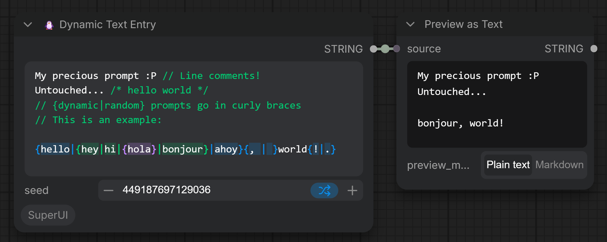

# ComfyUI-SuperUI

Frontend focused opinionated nodes for ComfyUI.

## Nodes

### Dynamic Text Entry

A multiline text node with comments and dynamic prompts highlights as you
type with seed support.

- `// line` and `/* block */` comments are supported in native text encoder textareas but are missing highlighting.
- `{red|green|blue}` is an example of a dynamic prompt. Normally in ComfyUI it picks one option at random but we can
  set the seed to fix if we need. Choices can nest, and you can use back slashes to escape curly braces if you need.
  For example, `\{`, `\}` and `\|` give literal characters.
- Unclosed `{` or `/*` and stray `}` are also highlighted as warnings.

Our behaviour differs the stock frontend's dynamic prompts by using a seed instead of `Math.random` and comments don't
leave blank lines in most cases. Settings live under **Settings → SuperUI**:

- **Dynamic Text** turns the whole feature off. When off, the text is sent
  exactly as typed and the highlighting disappears, so it's obvious which mode
  you're in. Turning it off makes the node useless!
- **Highlight dynamic prompt groups** shades each `{}` nesting level in its own
  color, so in `{hello|{hey|hi}|ahoy}` the `hello` and `ahoy` options share one
  color and `hey|hi` gets another.
